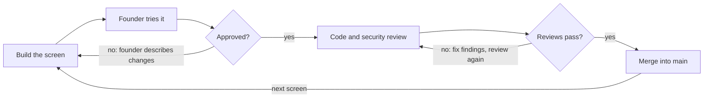

# App Pipeline Blueprint

Draft of 2026-10-08. The editable copy lives in the Claude Doc "App Pipeline Blueprint"; this file mirrors it.

## Overview

The pipeline takes a non-technical founder from an idea to a tested web or mobile app in 7 stages, and nothing moves forward until the founder approves. The founder never writes code or reads it; they answer questions, pick between options, try screens, and say yes or no.

It runs as a Claude Code plugin with one command per stage. Each stage reads the files earlier stages wrote and adds its own, so the founder can stop and resume at any point.

1. **Discover** (`/discover`): interview, market research, business plan
2. **Validate** (`/validate`): requirements checked for gaps, screen list agreed
3. **Design** (`/design`): design persona, style direction, every screen mocked up
4. **Architect** (`/architect`): code and cloud architecture, monthly cost estimate
5. **Set up** (`/setup`): GitHub repo, project scaffold, automated checks
6. **Build** (`/build`): one screen at a time, founder approval, code and security review, push
7. **QA** (`/qa`): test plan, bug ranking, fix and retest until clean

`/status` shows where the project is and what is waiting on the founder.

## Shared project state

Everything a stage produces is a file, so every later stage works from the same approved facts. Stages 1 to 4 write into a local `docs/` folder; stage 5 commits it into the new repo.

| File | Written by | Used by |
| --- | --- | --- |
| `pipeline/state.json` (current stage, approvals with dates, screen progress) | every stage | every stage, `/status` |
| `docs/01-business-plan.md` | Discover | Validate, Design, Architect |
| `docs/02-requirements.md` (user stories, acceptance criteria, screen list) | Validate | Design, Architect, Build, QA |
| `docs/03-design/` (persona, style guide, design tokens, screen mockups) | Design | Architect, Build |
| `docs/04-architecture.md` and `docs/04-cost-estimate.md` | Architect | Set up, Build |
| `docs/07-qa/test-plan.md` and the bug list | QA | QA |

An approval is recorded in `state.json` with the date, and changing an approved file later sends the affected stages back for re-approval.

## Stage 1: Discover

The founder describes the idea in their own words and leaves with a business plan they have approved.

- **Interview.** One plain-language question at a time, no jargon: the problem, who has it, how they solve it today, how the app makes money, competitors the founder knows, and the must-have features.
- **Market research.** Web research on competitors (features, pricing, reviews), the target market, and any rules that apply (payments, health data, children). Every figure links to the page it came from.
- **Business plan.** Problem, target customers, value proposition, competitor table, revenue model, first-version feature list, success metrics, and top risks.
- **Approval gate.** The founder reads the plan, asks for changes, and approves it.

## Stage 2: Validate

The business plan becomes a requirements document with no gaps, and its screen list drives everything after it.

- **Translate.** User roles, user stories, and acceptance criteria for each story, written so the founder can read them.
- **Check.** Every first-version feature maps to at least one story, and every story maps to a screen. Contradictions, missing flows (sign-up, password reset, empty states, errors), and scope that is too big for a first version are flagged.
- **Prioritise.** Each story is marked must have, should have, could have, or later.
- **Non-functional needs.** Web, mobile, or both; languages; expected number of users; privacy and data rules.
- **Approval gate.** The founder answers each flagged gap, then approves the requirements and the screen list.

## Stage 3: Design

Every screen on the list is designed in one distinctive style the founder chose, before any code is written.

**What "persona" means here.** There are two personas, and the design stage needs both:

- **User persona:** a short profile of the person the app is for, such as their age, goals, frustrations, and how comfortable they are with tech. It comes from the business plan.
- **Design persona:** the designer Claude acts as for this product, with a defined taste. For example, "an editorial designer who builds calm, print-inspired finance tools for people over 50." It sets the fonts, colours, layout habits, and tone of voice, so the UI looks designed by someone rather than produced by a template.

**Rules that keep it from looking AI-generated.** The style guide bans the usual defaults unless the brand calls for them: purple-to-blue gradients, the same single font everywhere, a centred hero above three feature cards, emoji as icons, glass effects, and placeholder text. Each product instead gets its own font pairing, a palette drawn from the brand's mood, one signature visual element, and real copy.

**Steps**

1. Write the user persona and design persona.
2. Produce 2 or 3 clearly different style directions as clickable sample screens; the founder picks one.
3. Turn the chosen direction into a style guide with design tokens (colours, type, spacing, corners).
4. Mock up every screen on the list, with its empty, loading, and error states.
5. Run a design critique, a UX copy review, and an accessibility check, then fix what they find.
6. **Approval gate:** the founder approves the screens.

Skills used: design critique, UX copy, accessibility review, and the theme and artifact design skills.

## Stage 4: Architect

The founder approves a stack and a monthly cloud budget they understand, before any code exists.

- **Decisions.** Platform (web, cross-platform mobile, or both), frontend and backend stack, database, sign-in, file storage, hosting, cloud provider, and third-party services such as payments, email, and maps.
- **Explained choices.** Each decision is a short record with 2 or 3 options, the trade-offs in plain language, and a recommendation. The default leans toward managed services with free tiers, so a small launch costs little.
- **Cost estimate.** A monthly cost per service at three usage levels (launch, growth, scale, with user counts taken from the business plan). Prices link to the provider's pricing page and carry the date they were checked.
- **Approval gate.** The founder approves the architecture and the launch-level budget.

## Stage 5: Set up

The app gets its own GitHub repo with a skeleton that builds, so every later change is checked automatically.

- Create the repo on the founder's GitHub account and commit the `docs/` folder from stages 1 to 4.
- Scaffold the project from the approved architecture, with the design tokens wired in.
- Add automated checks that run on every change: lint, type check, unit tests, dependency and secret scanning.
- Protect the main branch, so code only lands through a reviewed pull request.
- Write a `CLAUDE.md` with the project's coding standards, and a `.env.example`; real secrets never go in the repo.
- **Approval gate.** The founder opens a preview of the empty app running and confirms the repo is in place.

## Stage 6: Build, one screen at a time

A screen only reaches the main branch after the founder has tried it and approved it, and after it passes both code review and security review.

For each screen, in the order of the screen list:

1. Build the screen on its own branch, matching its approved mockup, with automated tests for its acceptance criteria.
2. Give the founder a way to try it: a preview link for web, or a QR code that opens it on their phone for mobile, plus a short "what to try" checklist.
3. The founder approves it or describes what is wrong in plain words. Changes go back to step 1 for that screen.
4. Once approved, run code review against the project's standards, then a security review. Any finding is fixed, and the founder re-checks the screen if the fix changed what it does.
5. Merge the pull request into main, record the approval in `state.json`, and move to the next screen.

The founder is only ever asked about behaviour; review findings are handled without them unless a fix changes what they approved.

## Stage 7: QA

The app is released only after a full test run finds no open bugs.

1. Generate a test plan from the requirements: every acceptance criterion becomes at least one test case, plus end-to-end journeys (sign up, the main task, payment if any), accessibility, basic performance, and a security scan.
2. Run it: automated end-to-end tests in a real browser or device simulator, then an exploratory pass on each screen.
3. Log each bug with steps to reproduce, a screenshot, and a severity (table below).
4. Fix bugs highest severity first. Each fix goes through the same code and security review as stage 6.
5. Rerun the whole test plan, not only the fixed parts, to catch anything a fix broke.
6. Repeat steps 3 to 5 until a full run is clean, then the founder signs off the release.

| Severity | Meaning | Example |
| --- | --- | --- |
| Critical | Crash, data loss, security hole, or money handled wrongly | Payment charged twice |
| High | A core feature is broken with no workaround | Cannot log in on Android |
| Medium | A feature works with a workaround, or fails in an edge case | Search ignores accented letters |
| Low | Cosmetic or wording | Button text cut off on small phones |

## Open questions

- [ ] Should the pipeline run as a Claude Code plugin (assumed here), or inside a Claude Project?
- [ ] Should it also deploy the finished app to production after QA? The current stage list ends at QA.
- [ ] For mobile apps, is a cross-platform app (one codebase for iPhone and Android) acceptable as the default?
- [ ] Should bugs live as GitHub issues in the app's repo, or in a file inside it?
