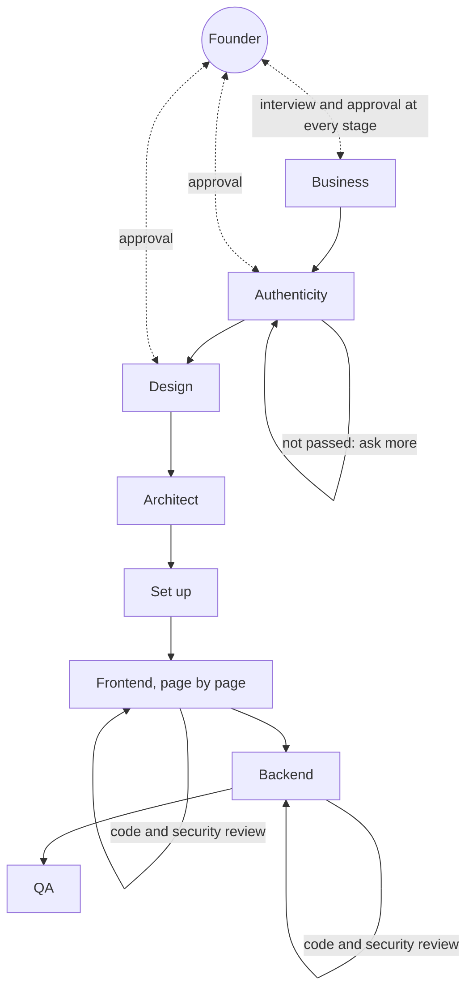
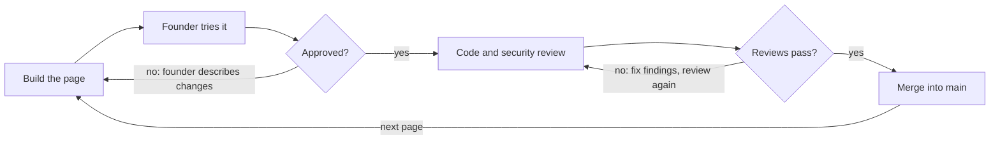

# App Pipeline Blueprint

Updated 2026-10-08. The editable copy lives in the Claude Doc "App Pipeline Blueprint"; this file mirrors it.

## Overview

The pipeline takes a non-technical founder from an idea to a tested web or mobile app in 8 stages, and nothing moves forward until the founder approves. The founder never writes code or reads it; they answer questions, pick between options, try pages, and say yes or no. The business documentation is written first, and every later stage refers back to it.

It ships two ways from the same skills: as a Claude Code plugin with one command per stage, and as skills added to a Claude Project, where the founder starts each stage by asking in chat. It stops once QA passes; deploying the app to production is out of scope. Each stage reads the files earlier stages wrote and adds its own, so the founder can stop and resume at any point.

1. **Business** (`/business`): interview, then the product's business documentation to the OP standard, one file group per feature
2. **Authenticity** (`/authenticity`): who the product is for, where it lives and how it must feel, scored and looped until it passes
3. **Design** (`/design`): screen list from the business documents, personas, style direction, every screen mocked up, using the frontend skills
4. **Architect** (`/architect`): code and cloud architecture, monthly cost estimate
5. **Set up** (`/setup`): GitHub repo, project scaffold, automated checks
6. **Frontend** (`/frontend`): every page on mocked data, one page at a time, founder approval, code and security review, push
7. **Backend** (`/backend`): existing or new backend, built with code and security review, wired to the frontend, run locally, founder tests and approves
8. **QA** (`/qa`): test plan, bug ranking, fix and retest until clean

Every stage reads the business documents and cites their IDs in what it produces.

`/status` shows where the project is and what is waiting on the founder.

## Shared project state

Everything a stage produces is a file, so every later stage works from the same approved facts. Stages 1 to 4 write into a local `docs/` folder; stage 5 commits it into the new repo.

| File | Written by | Used by |
| --- | --- | --- |
| `pipeline/state.json` (current stage, approvals with dates, screen progress) | every stage | every stage, `/status` |
| `docs/01-business/` (per feature: D1 Concept, D2 Features List, D3 Journeys as Word, Registries as Excel; plus a Shared group) | Business | every later stage |
| `docs/02-authenticity/` (`AUTHENTICITY.md`, card, scorecard, design brief) | Authenticity | Design and every later stage as a guard |
| `docs/03-design/` (screen list, persona, style guide, design tokens, screen mockups) | Design | Architect, Frontend |
| `docs/04-architecture.md` and `docs/04-cost-estimate.md` | Architect | Set up, Frontend, Backend |
| `docs/06-frontend/api-contract.md` | Frontend | Backend |
| `docs/07-backend/` (gap report if a backend exists, backend plan) | Backend | QA |
| `docs/08-qa/test-plan.md` and the bug list | QA | QA |

An approval is recorded in `state.json` with the date, and changing an approved file later sends the affected stages back for re-approval.

## Stage 1: Business

The founder describes the idea in their own words and leaves with business documentation they have approved. The standard is the OP Business Documentation skill, which replaces the earlier business plan and requirements stages.

- **Interview.** One plain-language question at a time: the problem, who has it, what the first version does, platform and languages, rules that apply, how the app makes money.
- **Product profile and features.** Name, ID prefix, definition type, and the product divided into features (usually 4 to 10), confirmed by the founder before any file is built.
- **Documents.** A Shared group and one group per feature: D1 Concept, D2 Features List and D3 Journeys (Word), and a Registries workbook (Excel) with entities, transitions, rules, permissions, tasks, notifications and user stories. One fact has one home and one ID, and every ID reference is a link.
- **Approval gate.** The founder reads the Shared D1, asks for changes, and approves.

## Stage 2: Authenticity

The documents are turned into a profile of the product's real people, place, purpose and presence, so that design does not default to the generic. The standard is the OP Authenticity process (4 lenses, 16 dimensions).

- **Capture and gaps.** Claude reads the business documents, marks each dimension Found, Partial or Missing, and asks only about the gaps.
- **Score and gate.** Each dimension is scored 0 to 3 and checked against the pass rules: no zeros, average of at least 2.0, the four critical dimensions at 2 or more, and the generic test resolved.
- **Loop.** If the gate says "not yet", Claude asks for what lifts the weak dimensions and runs it again, until it passes.
- **Approval gate.** The founder (and the authenticity lead, if there is one) approve. Claude never signs for anyone.

## Stage 3: Design

Every screen on the list is designed in one distinctive style the founder chose, before any code is written.

**What "persona" means here.** There are two personas, and the design stage needs both:

- **User persona:** a short profile of the person the app is for, such as their age, goals, frustrations, and how comfortable they are with tech. It comes from the business documents and the authenticity brief.
- **Design persona:** the designer Claude acts as for this product, with a defined taste. For example, "an editorial designer who builds calm, print-inspired finance tools for people over 50." It sets the fonts, colours, layout habits, and tone of voice, so the UI looks designed by someone rather than produced by a template.

**Rules that keep it from looking AI-generated.** The style guide bans the usual defaults unless the brand calls for them: purple-to-blue gradients, the same single font everywhere, a centred hero above three feature cards, emoji as icons, glass effects, and placeholder text. Each product instead gets its own font pairing, a palette drawn from the brand's mood, one signature visual element, and real copy.

**Steps**

1. List every screen the business documents call for, then write the user persona and design persona from the business documents and the authenticity brief.
2. Produce 2 or 3 clearly different style directions as clickable sample screens (phone and desktop when the platform is both), and tell the founder that all screens follow after they pick.
3. Turn the chosen direction into a style guide with design tokens (colours, type, spacing, corners).
4. Mock up every screen on the list, with its empty, loading, and error states.
5. Run a design critique, a UX copy review, and an accessibility check, then fix what they find.
6. **Approval gate:** the founder approves the screens.

Skills used: frontend-design and ui-ux-pro-max (required), refactoring-ui, web-typography (required), refactoring-ui, web-typography, ios-hig-design, microinteractions, ux-heuristics, and apple-design-system when an Apple-style direction is chosen, plus the design critique, UX copy, and accessibility review skills where installed.

## Stage 4: Architect

The founder approves a stack and a monthly cloud budget they understand, before any code exists.

- **Decisions.** Platform (web, cross-platform mobile, or both), frontend and backend stack, database, sign-in, file storage, hosting, cloud provider, and third-party services such as payments, email, and maps.
- **Explained choices.** Each decision is a short record with 2 or 3 options, the trade-offs in plain language, and a recommendation. The default leans toward managed services with free tiers, so a small launch costs little. Mobile apps default to cross-platform React Native (one codebase for iPhone and Android) unless the founder has a hard requirement for another stack.
- **Cost estimate.** A monthly cost per service at three usage levels (launch, growth, scale, with user counts taken from the business documents). Prices link to the provider's pricing page and carry the date they were checked.
- **Approval gate.** The founder approves the architecture and the launch-level budget.

## Stage 5: Set up

The app gets its own GitHub repo with a skeleton that builds, so every later change is checked automatically.

- Create the repo on the founder's GitHub account and commit the `docs/` folder from stages 1 to 4.
- Scaffold the project from the approved architecture, with the design tokens wired in.
- Add automated checks that run on every change: lint, type check, unit tests, dependency and secret scanning.
- Protect the main branch, so code only lands through a reviewed pull request.
- Write a `CLAUDE.md` with the project's coding standards, and a `.env.example`; real secrets never go in the repo.
- **Approval gate.** The founder opens a preview of the empty app running and confirms the repo is in place.

## Stage 6: Frontend, one page at a time

The whole frontend is built on mocked data before any backend exists. A page only reaches the main branch after the founder has tried it and approved it, and after it passes both code review and security review.

For each page, in the order of the screen list:

1. Build the page on its own branch, matching its approved mockup, with automated tests for its business acceptance criteria. Data comes from mocks behind a service interface, shaped like the business entities.
2. Give the founder a way to try it: a local link for web, or a QR code for mobile, plus a short "what to try" checklist.
3. The founder approves it or describes what is wrong in plain words. Changes go back to step 1 for that page.
4. Once approved, run code review against the project's standards, then a security review, and fix any finding.
5. Merge the pull request into main, record the approval in `state.json`, and move to the next page.

Every service function is recorded in `docs/06-frontend/api-contract.md`, which the backend stage builds to.

## Stage 7: Backend

The backend makes the data real. The stage starts by asking whether a backend already exists.

- **Existing backend.** Claude reads its API, writes a gap report against the frontend's contract and the business registries, and the founder decides the gaps that change cost, scope or what people see. By default the frontend's service layer adapts, not the pages.
- **From scratch.** Tables, state transitions, rules and permissions come straight from the business registries, built feature by feature, each with code review and security review and its own pull request.
- **Wire and run.** The real services replace the mocks behind the same interfaces. The whole app then runs on the founder's machine, and they get the full links, test accounts per role, and a "what to try" list.
- **Approval gate.** The founder tries the whole app and approves, or asks for changes. Nothing is deployed.

## Stage 8: QA

The app is released only after a full test run finds no open bugs.

1. Generate a test plan from the business documents: every acceptance criterion becomes at least one test case, plus end-to-end journeys (sign up, the main task, payment if any), accessibility, basic performance, a locale pass from the authenticity profile, and a security scan.
2. Run it: automated end-to-end tests in a real browser or device simulator, then an exploratory pass on each screen.
3. Log each bug as a GitHub issue in the app's repo, with steps to reproduce, a screenshot, and a severity label (table below).
4. Fix bugs highest severity first. Each fix is a pull request that links its issue ("Fixes #12"), goes through the same code and security review as stages 6 and 7, and closes the issue automatically when it merges.
5. Rerun the whole test plan, not only the fixed parts, to catch anything a fix broke.
6. Repeat steps 3 to 5 until a full run is clean, then the founder signs off the release.

| Severity | Meaning | Example |
| --- | --- | --- |
| Critical | Crash, data loss, security hole, or money handled wrongly | Payment charged twice |
| High | A core feature is broken with no workaround | Cannot log in on Android |
| Medium | A feature works with a workaround, or fails in an edge case | Search ignores accented letters |
| Low | Cosmetic or wording | Button text cut off on small phones |

## Decisions

Diab settled these on 8 October 2026.

| Question | Decision |
| --- | --- |
| Where does the pipeline run? | Both: a Claude Code plugin and skills for a Claude Project |
| Does it deploy to production? | No, it ends when QA passes |
| Mobile stack | Cross-platform React Native by default, unless the founder has a hard requirement |
| What replaced discover and validate? | The OP Business Documentation standard, as one Business stage (8 October 2026) |
| Is there an authenticity check? | Yes, a stage after Business that loops until the profile passes (8 October 2026) |
| How is development split? | Frontend on mocked data page by page, then Backend after asking whether one exists (8 October 2026) |
| Where do bugs live? | GitHub issues in the app's repo, linked from the fixing pull request and closed on merge |
